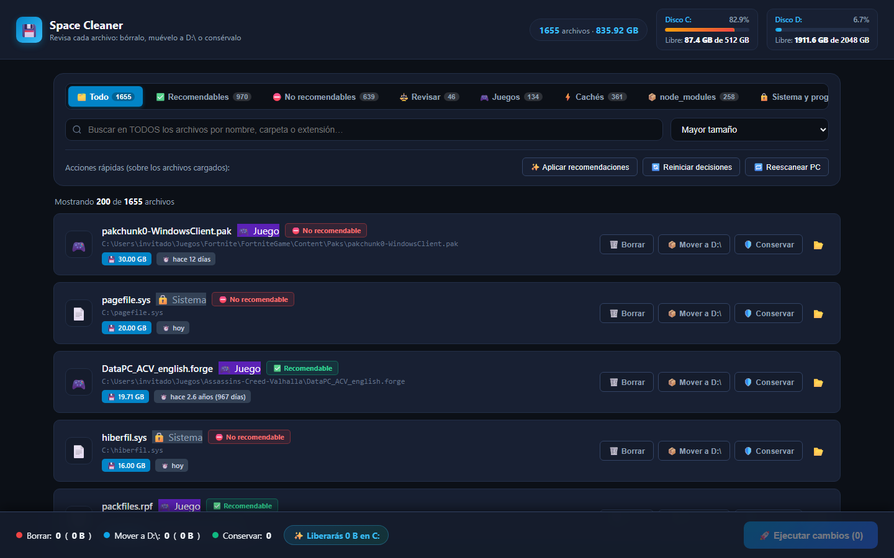

# 🗂️ Space Cleaner

Aplicación de escritorio para **evaluar y liberar espacio en Windows**. Indexa **todos los archivos de todos tus discos duros** — el conjunto completo, sin muestras ni recortes — y te deja revisarlos uno a uno: cada archivo se marca para **borrar**, **mover a otro disco** o **conservar**, y solo después se ejecuta todo en lote con confirmación.

Cada archivo lleva un **disclaimer de recomendación** y, al pasar el ratón por encima, un **cuadro de texto que explica el porqué**: por qué conviene eliminarlo o por qué no.

Interfaz moderna en modo oscuro, servida por un backend local en PowerShell y abierta como ventana de aplicación nativa (sin barra de navegación).



> 📸 Captura de la interfaz con datos de ejemplo: los archivos mostrados son ficticios, no corresponden a ningún equipo real.

---

## ✨ Características

| | |
|---|---|
| 🗃️ **Índice completo** | Recorre **todos los discos fijos** y cataloga cada archivo: nada queda fuera por tamaño ni por antigüedad |
| 🏷️ **Clasificación automática** | Detecta sistema, programas instalados, juegos, cachés, `node_modules` y proyectos en desarrollo |
| ✅ **Disclaimer de recomendación** | Tres estados por archivo: **Recomendable**, **No recomendable** y **Revisar** |
| 💬 **Tooltip explicativo** | Al pasar el cursor: *por qué* se recomienda o no eliminar ese archivo concreto, con su tamaño y su antigüedad |
| 🔍 **Búsqueda instantánea** | Filtra los cientos de miles de archivos por nombre, carpeta o extensión (respuesta en menos de un segundo) |
| 📊 **Panel de discos** | Uso y espacio libre de tus discos en tiempo real |
| ⚡ **Acciones rápidas** | Aplicar recomendaciones, reiniciar decisiones, reescanear el equipo |
| 🛡️ **Protección de sistema** | Se valida **en el servidor**: `C:\Windows`, `Program Files`, `pagefile.sys`, `hiberfil.sys` y el resto del sistema nunca se pueden borrar ni mover |
| ⚠️ **Aviso de proyectos** | Advertencia explícita si vas a tocar una carpeta de proyecto activo |
| 📦 **Movimiento estructurado** | `C:\Users\...\juegos\j.zip` → `D:\Users\...\juegos\j.zip` recreando la estructura de carpetas |
| 🔙 **Sin sorpresas** | Modal de confirmación con el detalle completo antes de tocar nada |

### Cómo decide la recomendación

| Estado | Cuándo aparece |
|---|---|
| ✅ **Recomendable** | Cachés y temporales (se regeneran solos), `node_modules` (se recrea con `npm install`), y todo lo que lleva **más de un año** sin tocarse |
| ⛔ **No recomendable** | Archivos de **Windows**, **programas instalados**, tus **proyectos activos**, y cualquier archivo modificado en los **últimos 30 días** |
| ⚖️ **Revisar** | Lo que no es obvio: archivos con una antigüedad intermedia. Ahí decides tú |

Los archivos de **sistema y de programas instalados** aparecen en la lista para que veas *todo*, pero sus botones de borrar/mover están bloqueados: se rechazan en el servidor, no solo en la interfaz.

---

## 📋 Requisitos

- **Windows 10 / 11**
- **PowerShell 5.1** (viene con Windows)
- **Microsoft Edge o Google Chrome** (para la ventana de la app)

No requiere instalación, dependencias ni privilegios de administrador.

---

## 🚀 Uso rápido

### 1. Lanza la app

Doble clic en **`iniciar.bat`**

La app es **portátil**: descomprime la carpeta donde quieras (Escritorio, `Documentos`, un pendrive…) y ejecútala desde ahí. No instala nada, no necesita permisos de administrador y **no usa ninguna ruta propia de otro ordenador**: todo vive dentro de esa misma carpeta.

El script arranca el servidor en segundo plano, espera a que esté listo y abre la aplicación en Edge o Chrome en **modo app** (si no hay ninguno, en tu navegador por defecto). Si vuelves a ejecutarlo, reutiliza el servidor que ya esté corriendo.

### 2. Escanea tu equipo (solo la primera vez)

La primera vez no hay índice: la app te ofrece **«Escanear mi PC ahora»**. Recorre todos los discos fijos y construye el índice completo con una barra de progreso en vivo.

> ⏱️ En un equipo con medio millón de archivos tarda unos pocos minutos. El índice se guarda en tu carpeta de usuario y, a partir de ahí, la app arranca al instante. Puedes repetirlo cuando quieras con **«Reescanear PC»**.

### 3. Evalúa archivo a archivo

1. Elige la pestaña: **Todo**, **Recomendables**, **No recomendables**, **Revisar**, **Juegos**, **Cachés**, **node_modules**, **Sistema y programas** o **Proyectos**.
2. Pasa el ratón por el disclaimer para leer **por qué** se recomienda o no.
3. Pulsa **Borrar**, **Mover a D:\\** o **Conservar** en cada tarjeta.
4. Revisa el contador de la barra inferior.
5. Pulsa **Ejecutar Cambios** y confirma en el modal.

---

## 🗂️ Estructura del proyecto

```
space-cleaner/
├── app.html        # Interfaz (HTML + CSS + JS, sin dependencias)
├── server.ps1      # API local: índice en memoria, discos, borrado y movimiento
├── scanner.ps1     # Escáner de discos (proceso aparte, con progreso)
├── iniciar.bat     # Lanzador: arranca servidor + abre ventana Edge
├── .gitignore      # Excluye el índice y cualquier dato del usuario
└── README.md
```

---

## 🔌 API local

El servidor escucha solo en `http://localhost:39841/` (nunca expuesto a la red).

| Método | Ruta | Descripción |
|---|---|---|
| `GET` | `/` | Sirve `app.html` |
| `GET` | `/api/state` | Estado del índice: total de archivos, bytes y contadores por categoría |
| `GET` | `/api/files?offset&limit&q&group&sort` | Página del índice, con filtrado y orden en el servidor |
| `GET` | `/api/scan` | Progreso del escaneo (`POST` para iniciarlo) |
| `GET` | `/api/disks` | Espacio total/libre de tus discos |
| `GET` | `/api/reveal?path=` | Abre el Explorador en la ruta indicada |
| `POST` | `/api/execute` | Ejecuta `{ actions: [{ path, action }] }` |
| `POST` | `/api/shutdown` | Detiene el servidor |

Acción válida: `delete` o `move`.

---

## 🔒 Seguridad y privacidad

Esta app está pensada para **cualquier persona y cualquier equipo**, así que cada usuario es el único que ve sus propios archivos:

- **Nada sale de tu ordenador.** El servidor solo acepta conexiones **loopback** (`localhost`); no está accesible desde tu red y no realiza ninguna petición a internet.
- **Tu índice es tuyo.** El inventario completo (`index.csv`) se genera junto al propio `server.ps1`, dentro de la carpeta donde hayas descomprimido la app: nunca en el Escritorio, nunca en una carpeta compartida. Es un archivo local más, con tus rutas y tus tamaños.
- **Nunca se sube a ningún sitio.** `.gitignore` excluye el índice, el volcado temporal, el archivo de progreso y cualquier CSV: el repositorio solo contiene el código de la app.
- **Las capturas del README usan datos ficticios**, con un usuario inventado, para no mostrar el equipo de nadie.
- **El sistema está blindado en el servidor.** Aunque manipules las peticiones a mano, `C:\Windows`, `Program Files`, `ProgramData`, `$Recycle.Bin`, `System Volume Information` y los archivos del núcleo se rechazan antes de tocar nada.
- **Tú mandas.** Nada se borra ni se mueve sin que lo confirmes en el modal, y cada tarjeta se puede marcar como «Conservar» para dejarla en paz.

---

## 🧪 Verificado

| Prueba | Estado |
|---|---|
| Escaneo completo de todos los discos (492.430 archivos / 466 GB) | ✅ |
| Índice en memoria: búsqueda de 492.430 archivos en <1 s | ✅ |
| Paginación y scroll infinito sin congelar la interfaz | ✅ |
| Badges ✅ / ⛔ / ⚖️ y tooltip explicativo al pasar el ratón | ✅ |
| Mover archivo C: → D: (creando estructura) | ✅ |
| Borrar archivo | ✅ |
| Rechazar `C:\Windows\notepad.exe` | ✅ |
| Rechazar `C:\Program Files\...\chrome.exe` | ✅ |
| Rechazar rutas manipuladas (`..\..\Windows\...`) | ✅ |
| Rechazar acciones que no sean `delete` o `move` | ✅ |
| Carpeta de proyecto marcada como protegida | ✅ |

---

## 🤖 Desarrollo asistido con agentes de IA

Esta app se ha desarrollado con **agentes de IA** como parte del flujo de trabajo.

- **El agente de IA** se encarga de la implementación, de escribir el código de la interfaz, el servidor PowerShell y el escáner, y de ejecutar las pruebas manuales que recoge la tabla de arriba.
- **Carlos Arnanz** define los requisitos (qué indexa, qué se protege, cómo se decide cada recomendación), toma las decisiones de diseño y de seguridad, revisa cada cambio y valida la app en un equipo real antes de darla por terminada.

La app se ha verificado contra un equipo con más de 492.000 archivos; los resultados de esa validación son los de la sección «Verificado».

---

## 📄 Licencia

MIT

---

## 👤 Autor

**Carlos Arnanz** — [github.com/carlosarnu](https://github.com/carlosarnu)
